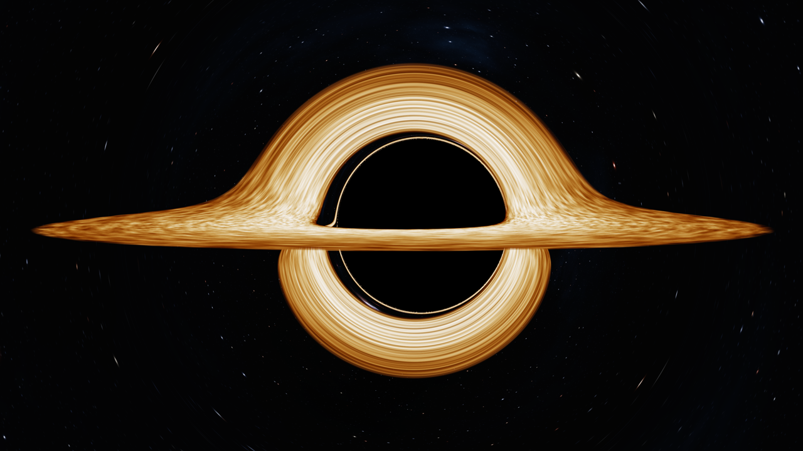
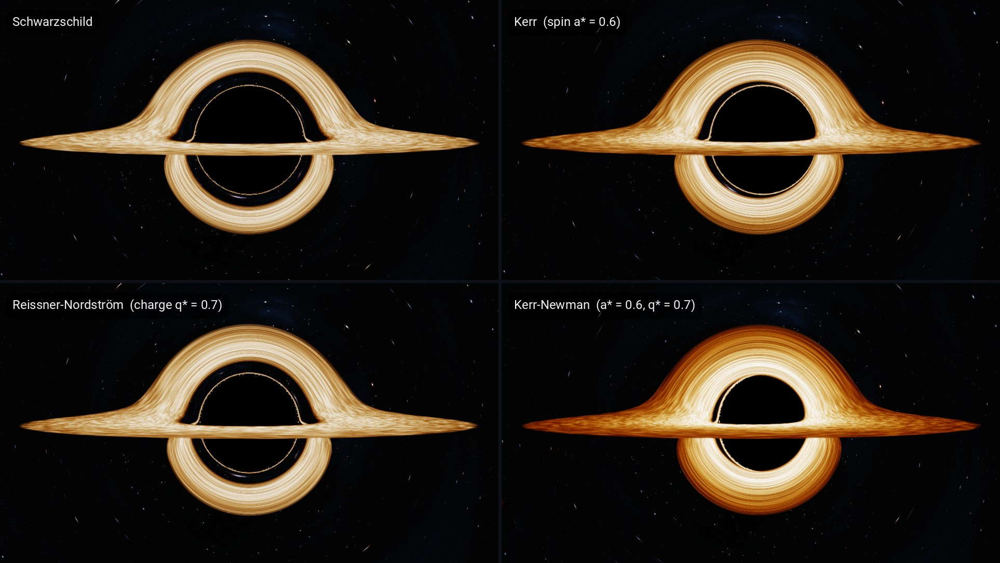
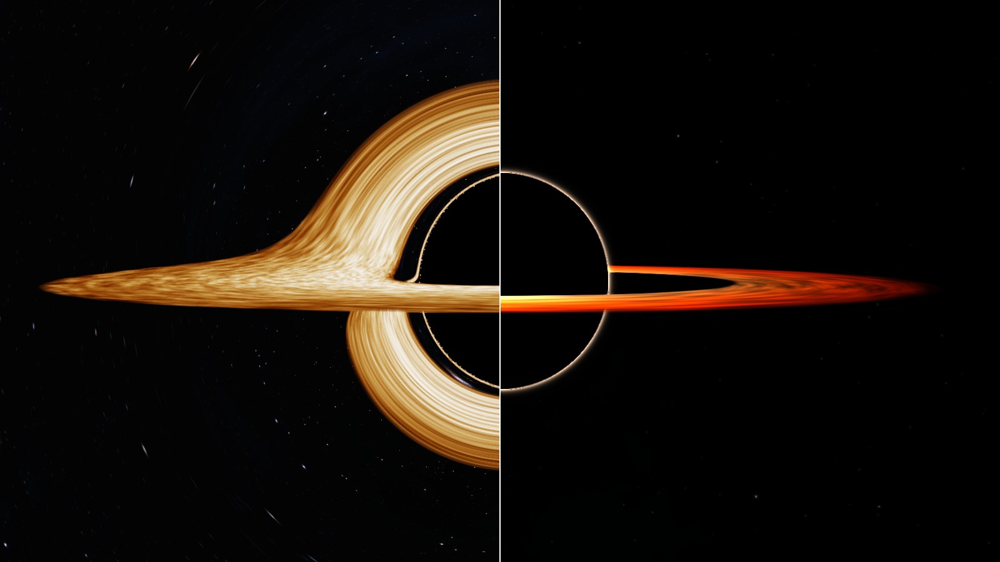
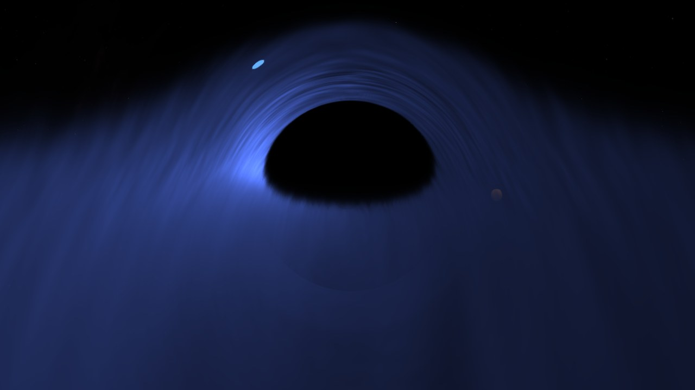
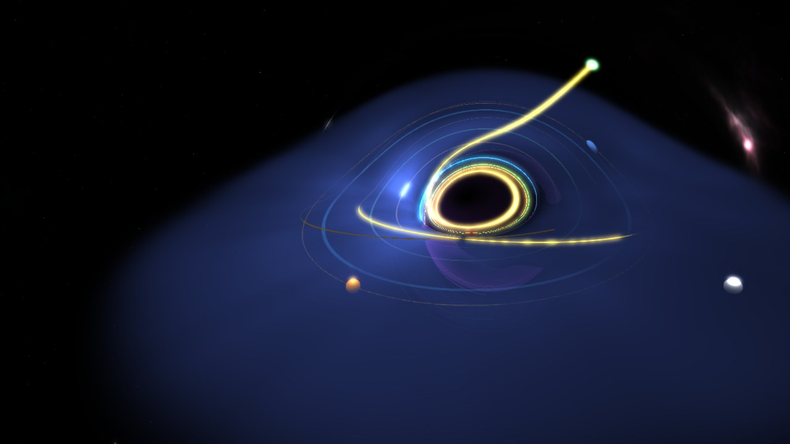
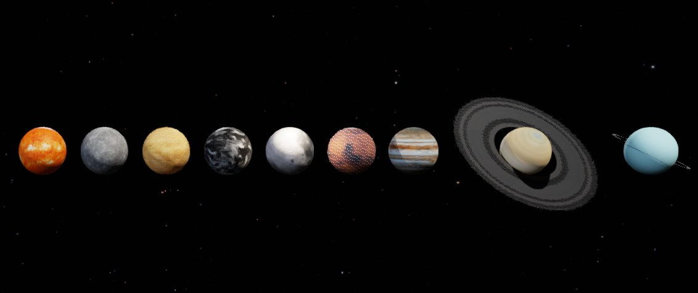
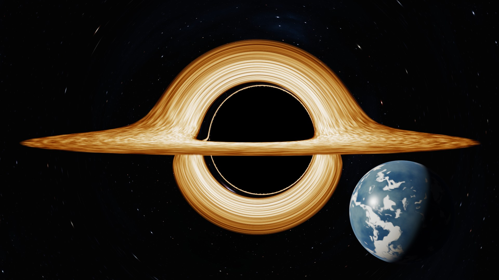
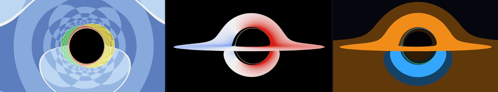
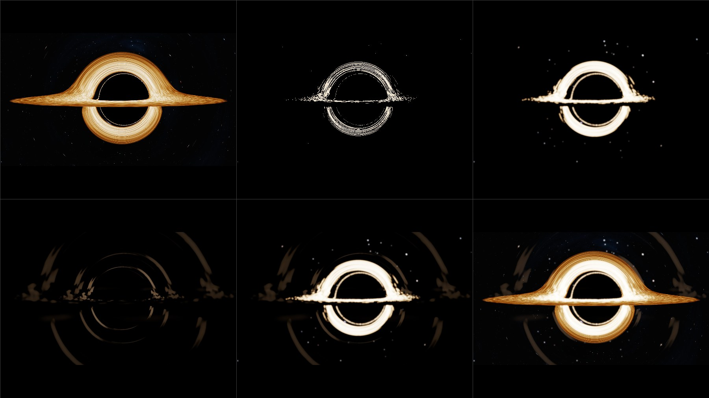

# MoleHole

**Real-time black hole rendering and General Relativity sandbox.** 
MoleHole traces light along the null geodesics of Schwarzschild, Kerr, Reissner–Nordström 
and Kerr–Newman spacetimes on the GPU, lights an accretion disk from its physical 
temperature, redshift and Doppler beaming, and lets you build scenes around it in an 
editor with N-body and rigid-body physics, a visual node graph and Luau scripting. 
C++23 and Vulkan, built on the separate [`gpp`](https://github.com/g-martin772/gpp) framework.



<p align="center"><sub>A Kerr black hole with a* = 0.6 in the look of <i>Interstellar</i>: like the film, 
Doppler beaming and gravitational redshift are switched off, which keeps the disk symmetric 
(<code>templates/gargantua-film.yaml</code>). Every picture on this page is rendered by MoleHole; 
<code>tools/gen_readme_images.sh</code> re-creates them.</sub></p>

## One hole, four spacetimes


<sub>The same hole, camera and disk; only <code>spacetime.solution</code> changes 
(<code>templates/four-spacetimes.yaml</code>). Charge pulls the horizon, the photon ring and the 
innermost stable orbit inwards, so the shadow shrinks and the disk reaches closer (Reissner–Nordström). 
Spin does the same on the side where the disk comes towards you and makes the shadow lopsided (Kerr). 
Kerr–Newman has both; its inner edge gets so much hotter that the rest of the disk looks 
redder by comparison.</sub>

## Gallery

<table>
  <tr>
    <td width="50%"><br><sub><b>A/B split.</b> Left: geodesic ray tracing. Right: the same frame with straight light rays. The "hat" over the shadow is the far side of the disk, bent over the hole.</sub></td>
    <td width="50%"><br><sub><b>Close to the horizon.</b> A hole at the Thorne limit (a* = 0.998) with bodies on exact Kerr geodesics; seen from this close, the disk wraps over the top of the shadow.</sub></td>
  </tr>
  <tr>
    <td width="50%"><br><sub><b>Orbits around a spinning hole.</b> a* = 0.9: bodies on exact Kerr geodesics with their predicted paths (yellow), and the photon orbit, marginally bound orbit and ISCO as rings, all traced through the metric so they are lensed like the disk.</sub></td>
    <td width="50%"><br><sub><b>Planets.</b> Textured bodies with rings, each lit by what its own sky probe sees; atmospheres, clouds and terrain are components too.</sub></td>
  </tr>
</table>


<sub><b>Miller's planet and Gargantua</b>, composed like the film (<code>templates/millers-planet.yaml</code>): the a* = 0.6 hole of the film's images with an ocean world in the foreground, lit by a key light and by what its own sky probe sees of the disk. On its real orbit, only 4 × 10⁻⁵ M outside the horizon of a near-extremal hole, the planet sits in the plane of the disk and the whole sky turns into disk light; <code>templates/interstellar-bodies.yaml</code> renders that view.</sub>

## See what the renderer does

MoleHole is built to explain the picture, not only to make it. Apart from the ray inspector, which is a viewport mode, every tool below is a render setting, so it works in the editor, in scripts and in headless exports.


<sub>Left: **checkerboard sky** — a latitude/longitude grid on the celestial sphere; lensing stretches, mirrors and repeats it in ever thinner rings around the shadow. Middle: **redshift** of the disk light — blue where the gas comes towards you, red where it recedes and deep in the gravity well. The scene's film look switches the colour shift off; the debug view still shows the physical one. Right: **image order** — the direct image of the disk (orange), its far side bent around the hole (blue), the photon rings (green, white).</sub>

- **Ray inspector:** click any pixel and its light ray is traced backwards through the metric and drawn into the scene, with its impact parameter, closest approach, windings and the redshift at every disk crossing.
- **A/B split:** compare two profiles, or one setting on and off (Doppler, redshift, bloom, lensing), on either side of a draggable divider.
- **Pipeline stages:** look at every intermediate image of the render pipeline with its GPU time.
- **Tracer diagnostics:** step count heat map, termination reason, geodesic constraint drift, ergosphere and ISCO.
- **Overlays:** characteristic radii (horizon, ergosphere, photon orbit, ISCO), predicted geodesic orbits, osculating orbits, tidal-tensor axes, gravity grid, collider wireframes.


<sub>The pipeline-stage mosaic: traced image, bloom bright pass, bloom, lens flare, everything post-processing adds, and the final frame (bloom and flares switched on for this picture; the film look keeps them off).</sub>

## Features

**Physics**
- Null geodesics of the full Kerr–Newman family, integrated on the GPU in f32 or f64; an analytic lens for interactive frame rates and straight rays for editing
- Thin or volumetric accretion disk: inner edge at the ISCO, Page–Thorne temperature from the hole's mass and accretion rate, Keplerian rotation, gravitational redshift and Doppler beaming from the metric
- Observers: ZAMO, static, orbiting or free-falling camera, with aberration and Doppler shift of what it sees
- Bodies on exact timelike geodesics, N-body gravity with 1PN corrections, PhysX rigid bodies, tidal forces
- SI units everywhere; near-extremal holes (a* up to 1 − 10⁻¹⁴) stay accurate

**Editor**
- Scene outliner and inspector generated from reflected components, undo/redo, gizmos, camera bookmarks
- Render profiles (Flat, Lensed, Traced, Reference) with every setting searchable, cost-rated and scriptable
- Visual animation graph that transpiles to Luau, Luau script components, hot-reloaded UI plugins and shaders
- Headless image, video and PNG-sequence export, each with a sidecar of every resolved setting for reproducibility

## Build
Needs `VCPKG_ROOT`, CMake >= 4.4, Ninja and GCC 16 (`import std`). The `gpp` framework is expected at `dependencies/gpp`.

```sh
cmake --preset vcpkg && cmake --build --preset vcpkg
build/molehole_tests
```

## Run
From the repository root:

```sh
build/MoleHole
build/MoleHole --scene templates/gargantua-film.yaml
```

Example scenes are in `templates/`: `gargantua-film` (the picture at the top), `four-spacetimes` (one hole with spin and charge, for switching `spacetime.solution`), `millers-planet` (the film composition above), `gargantua-orbits` (Thorne-limit spin, geodesic bodies), `interstellar-bodies` (Miller's planet near a near-extremal hole), `solar-system-black-hole` (the Sun swapped for a black hole of the same mass, planets on JPL ephemerides), `m1-orbits` (frame dragging on Kerr orbits), `sgr-a-star`, `model-showcase`. Planet maps are not in git: `python3 tools/fetch_textures.py` and `python3 tools/gen_planet_textures.py`.

## Command line
```sh
build/MoleHole --export-image out.png --width 1920 --height 1080 --scene templates/gargantua-film.yaml --scene-camera
build/MoleHole --export-image out.png --profile Traced --set debug.view=Redshift
build/MoleHole --export-image out.png --set compare.profile=Flat            # A/B split in an export
build/MoleHole --export-video out.mp4 --duration 10 --fps 60
build/MoleHole --simulate templates/dev.yaml --ticks 600 --out state.yaml
build/MoleHole --validate-scene templates/dev.yaml
build/MoleHole --list-settings
build/MoleHole --dump-schema
```

Exports write a `.render.yaml` sidecar with every resolved setting next to the output. All flags and exit codes: [docs/export-instructions.md](docs/export-instructions.md).

## Documentation
- [User guide](docs/USER_GUIDE.md): windows, keybinds, render profiles, debug tools, components, animation graph, scripting, exports
- [Developer guide](docs/DEV_GUIDE.md): architecture, units, adding components and render settings
- [Export instructions](docs/export-instructions.md)
- [Release 1.0 goal](docs/RELEASE_1_GOAL.md): recreating *Interstellar* scientifically
- Physics notes in [`docs/notes/`](docs/notes) and the project paper in [`docs/paper/`](docs/paper)

## Layout
- `src/` app code as C++ modules, `plugins/` hot-reloadable UI layers
- `scripts/` Luau script components, `combos/` graph templates, `templates/` example scenes, `shaders/`
- `tests/unit/` Catch2 tests, `tools/` data generators, benchmarks and `gen_readme_images.sh`

## License
[GPL-3.0](LICENSE)
