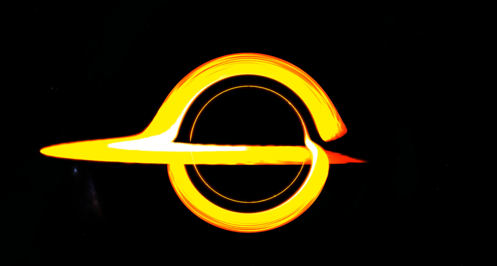

# MoleHole

Real-time and offline black hole renderer and physics sandbox. Geodesic ray tracing in Schwarzschild, Kerr, Reissner-Nordstrom and Kerr-Newman spacetimes, accretion disks, planets, and an N-body / PhysX scene editor with a node-based animation graph and Luau scripting. C++23 and Vulkan, built on the separate `gpp` framework.



## Build
Needs `VCPKG_ROOT`, CMake >= 4.4, Ninja and GCC 16 (`import std`). The `gpp` framework is expected at `dependencies/gpp`.

```sh
cmake --preset vcpkg && cmake --build --preset vcpkg
build/molehole_tests
```

## Run
From the repository root:

```sh
build/MoleHole
build/MoleHole --scene templates/dev.yaml
```

## Command line
```sh
build/MoleHole --export-image out.png --width 1920 --height 1080 --scene templates/dev.yaml --profile Traced
build/MoleHole --export-video out.mp4 --duration 10 --fps 60
build/MoleHole --simulate templates/dev.yaml --ticks 600 --out state.yaml
build/MoleHole --validate-scene templates/dev.yaml
build/MoleHole --list-settings
build/MoleHole --dump-schema
```

Exports write a `.render.yaml` sidecar with every resolved setting next to the output. All flags and exit codes: [docs/export-instructions.md](docs/export-instructions.md).

## Documentation
- [User guide](docs/USER_GUIDE.md): windows, keybinds, render profiles, components, animation graph, scripting, exports
- [Developer guide](docs/DEV_GUIDE.md): architecture, units, adding components and render settings
- [Export instructions](docs/export-instructions.md)

## Layout
- `src/` app code as C++ modules, `plugins/` hot-reloadable UI layers
- `scripts/` Luau script components, `combos/` graph templates, `templates/` example scenes, `shaders/`
- `tests/unit/` Catch2 tests
